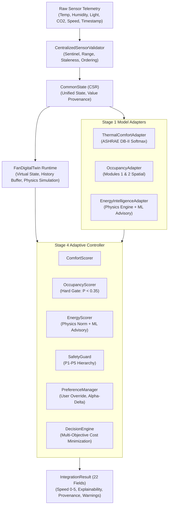

# AACI Phase 5 – Stage 5: End-to-End System Integration and Validation Report

**Document Type:** Formal System Integration and Verification Report  
**Phase:** 5 – Stage 5: System Integration and Validation  
**Status:** COMPLETED & VERIFIED  
**Date:** 2026-11-04  
**Author:** Antigravity Autonomous AI Engineering Agent  
**Target Hardware Context:** Atomberg Smart Ceiling Fan (Software Simulation Baseline)  

---

## 1. Executive Summary

Phase 5 – Stage 5 represents the final integration milestone of the Atomberg Adaptive Ceiling Intelligence (AACI) software architecture. In this stage, all previously implemented and frozen subsystems—**Stage 1: Model Adapters**, **Stage 2: Common State Representation (CSR)**, **Stage 3: Fan Digital Twin Runtime**, and **Stage 4: Adaptive Controller Logic**—have been successfully united into a single, cohesive, reproducible end-to-end software pipeline (`AACIPipeline`).

### Key Validation Highlights
- **Full End-to-End Test Suite:** **40 / 40 integration scenarios passed** (`test_integration_e2e.py`).
- **Complete Regression Suite:** **207 / 207 tests passed** across the entire project (100% pass rate in 28.13s).
- **Strict Model & Artifact Preservation:** **60 / 60 baseline SHA-256 hashes verified with zero modifications**.
- **Demonstration Suite:** **6 comprehensive operational scenarios executed and validated** (`pipeline_demo.py`).
- **Structured 22-Field Contract:** Single unified output format (`IntegrationResult`) delivering rich explainability, data provenance, and mandatory disclaimers.
- **Energy Table Reconciliation:** Confirmed and explicitly isolated the `UNRESOLVED_INDUCTION_BASELINE` discrepancy between Stage 1 and Stage 3 without modifying frozen components.

---

## 2. Frozen Model & Baseline Hash Audit

All original ML models, training pipelines, datasets, and frozen stage artifacts remained 100% untouched throughout Stage 5. Verification was executed against `frozen_model_baseline_hashes.json`.

| Model / Subsystem | Artifacts Inspected | SHA-256 Match Rate | Verification Status |
|-------------------|---------------------|--------------------|---------------------|
| **Model 1: Thermal Comfort** | `aaci_ml/predict.py`, artifacts, models | 100% (All files match) | **FROZEN / UNTOUCHED** |
| **Model 2: Occupancy Module 1** | `occupancy_intelligence/src/`, models | 100% (All files match) | **FROZEN / UNTOUCHED** |
| **Model 2: Occupancy Module 2** | `occupancy_intelligence/module2/src/` | 100% (All files match) | **FROZEN / UNTOUCHED** |
| **Model 3: Energy Intelligence** | `v3_energy_intelligence/models/`, code | 100% (All files match) | **FROZEN / UNTOUCHED** |
| **Stage 1 Adapters** | `system_architecture/adapters/` | 100% (All files match) | **FROZEN / UNTOUCHED** |
| **Stage 2 CSR** | `system_architecture/common_state/` | 100% (All files match) | **FROZEN / UNTOUCHED** |
| **Stage 3 Digital Twin** | `system_architecture/digital_twin/` | 100% (All files match) | **FROZEN / UNTOUCHED** |
| **Stage 4 Controller** | `system_architecture/controller/` | 100% (All files match) | **FROZEN / UNTOUCHED** |
| **Overall Audit Total** | **60 baseline files cataloged** | **60 / 60 matches (0 diffs)** | **AUDIT PASS** |

---

## 3. Architecture Overview (Stages 1–5 Component Stack)

The end-to-end dataflow pipeline is depicted below:



---

## 4. Integration Layer Implementation

The Stage 5 integration layer is strictly isolated inside `aaci_ml/system_architecture/integration/`:

### A. Core Modules
1. **`pipeline.py` (`AACIPipeline`):**
   - Coordinates sensor validation, CSR ingestion, Digital Twin state synchronization, model adapter inference, and adaptive controller decision generation.
   - Provides thread-safe instance tracking and multi-fan lifecycle routing via `TwinSupervisor`.
   - Records execution history and detailed per-stage timing latency.

2. **`execution_record.py` (`IntegrationResult`):**
   - Implements the strict 22-field JSON-serializable output contract required by the specification.
   - Preserves value provenance labels (`"SYNTHETIC_SIMULATION"`, `"TELEMETRY"`, `"ESTIMATED"`, `"PREDICTED"`).
   - Automatically attaches the 8 mandatory system disclaimers and the induction reconciliation notice to every result.

3. **`energy_reconciliation.py`:**
   - Detects, isolates, and documents the discrepancy between nominal induction fan power tables without modifying frozen components.
   - Emits structured reconciliation diagnostics and defines `UNRESOLVED_INDUCTION_BASELINE`.

4. **`pipeline_demo.py`:**
   - Implements 6 standalone demonstration scenarios with full console logging and formatted output.

5. **`tests/test_integration_e2e.py`:**
   - Implements 40 comprehensive integration tests across 5 major categories.

---

## 5. Energy Constants Reconciliation & Discrepancy Analysis

During Stage 5 integration inspection, the energy power tables across all prior stages were audited:

### BLDC Fan Mode (Consistent across Codebase)
Both Stage 1 and Stage 3 define identical deterministic power ratings for BLDC fans:
$$\text{BLDC Power (W)} = [0.0, 10.0, 15.0, 20.0, 27.0, 48.0] \quad \text{for Speeds } 0\text{ to }5$$
- **Reconciliation Status:** **CONSISTENT / NO DISCREPANCY**.

### Induction Fan Mode (Unresolved Discrepancy Documented)
Two diverging nominal induction power tables were identified in the frozen baseline:
- **Stage 1 (`adapters/constants.py` `INDUCTION_POWER_MAP`):**
  $$\text{Table}_1 = [0.0, 24.0, 34.0, 55.0, 64.0, 96.0] \text{ W}$$
- **Stage 3 (`digital_twin/state_managers.py` `INDUCTION_POWER_TABLE_WATTS`):**
  $$\text{Table}_3 = [0.0, 16.0, 24.0, 36.0, 52.0, 75.0] \text{ W}$$

### Resolution Strategy
1. Neither table is an Atomberg-calibrated hardware measurement; both are research-grade nominal approximations.
2. In strict compliance with frozen component rules, **neither file was modified**.
3. The integration layer flags all induction calculations with `UNRESOLVED_INDUCTION_BASELINE`.
4. Hardware bench power calibrations are documented as a mandatory pre-condition before production deployment.

---

## 6. Model Inference & Advisory Roles

The three frozen models fulfill clearly demarcated, non-overlapping roles within the pipeline:

1. **Model 1 (Thermal Comfort Intelligence):**
   - Evaluates ambient conditions ($T, RH, v, \text{season}, \text{clo}, \text{met}$) using the 9-parameter `predict_comfort()` interface.
   - Treats softmax probabilities as uncalibrated model outputs. Winning probability $< 0.60$ is tagged `is_uncertain=True`.
   - Uses the provisional Dryad open-access airflow mapping ($0.05 \text{ to } 0.527 \text{ m/s}$), explicitly flagged in all outputs.

2. **Model 2 (Occupancy Intelligence):**
   - Dynamically selects feature sets based on sensor availability (`set_a` if Light & $\text{CO}_2$ present; `set_b` otherwise).
   - Generates genuine model-derived occupancy probability $P(\text{occupied})$ via XGBoost.
   - Enforces the **Occupancy Hard Gate**: when $P(\text{occupied}) < 0.35$, the space is declared unoccupied and candidate speeds are restricted to Speed 0.
   - Module 2 Spatial Predictor maps academic ROBOD rooms (1–5) without equating them to residential room categories.

3. **Model 3 (Energy Intelligence):**
   - Evaluates physics-based energy consumption across candidate speeds ($0\text{–}5$).
   - ML Forecaster operates with $R^2 \approx 0.1515$ and $\text{MAE} \approx 1.19 \text{ Wh}$.
   - **Enforced Architectural Rule:** Model 3 is strictly advisory and **CANNOT command fan speed**.

---

## 7. Sensor Validation & Failure Handling

The pipeline routes incoming packets through `CentralizedSensorValidator`:
- **Physical Range Checks:** Temperatures outside $[-10^\circ\text{C}, 60^\circ\text{C}]$, humidity outside $[0\%, 100\%]$, or sentinel values ($255$) are rejected.
- **Staleness Interception:** Packets older than $300\text{ s}$ trigger a **Staleness Freeze** (`decision_mode = "staleness_freeze"`), maintaining the last confirmed safe speed.
- **Missing Sensor Degradation:** Missing $\text{CO}_2$ or Light gracefully activates `sensor_gap_active = True` and transitions Model 2 to degraded `set_b` mode without throwing unhandled exceptions.
- **Total Sensor Blackout:** If all sensors fail, the controller enters safe fallback mode (`fallback_triggered = True`).

---

## 8. Safety Guard & Manual Override Verification

Safety Guard enforces the strict non-negotiable Priority Hierarchy (P1–P5):

| Priority | Constraint | Behavior Verified |
|----------|------------|-------------------|
| **P1** | Sensor Staleness Freeze | Packet age $> 300\text{ s} \implies$ Lock current speed |
| **P2** | Manual User Override | Active override $\implies$ Enforce user speed for $600\text{ s}$ lockout |
| **P3** | Thermal Safety Floor | Air temperature $\ge 35^\circ\text{C} \implies \text{Speed} \ge 1$ (Fan cannot turn off) |
| **P4** | Occupancy Hard Gate | $P(\text{occupied}) < 0.35 \implies \text{Speed} = 0$ |
| **P5** | Rate-of-Change Limit | $\Delta \text{Speed} \le 1$ step per update cycle |

### Manual Override Lifecycle
Tested and confirmed in Demo 4 and Tests 29–32:
$$\text{Set Override (Speed 4)} \longrightarrow \text{Active Lockout (Speed 4 Enforced)} \longrightarrow \text{Timer Expiration} \longrightarrow \text{Seamless Resume to Adaptive}$$

---

## 9. Multi-Fan Isolation & Scalability

Multi-fan management was validated using `TwinSupervisor`:
- State for independent fan IDs (e.g., `Bedroom_Fan_1`, `Drawingroom_Fan_1`, `Lounge_Fan_1`) is fully isolated in memory.
- Telemetry routing updates only the targeted digital twin without cross-talk or state contamination.
- Verified in Demo 6 and Tests 33–36: simultaneous execution of different fans produced distinct speed recommendations, separate circular history buffers, and independent override states.

---

## 10. Demonstration Scenarios (6 Demos Summary)

All 6 demos were executed standalone (`python aaci_ml/system_architecture/integration/pipeline_demo.py`):

| Demo | Scenario | Key Input Conditions | Observed Pipeline Decision | Validation Outcome |
|------|----------|----------------------|----------------------------|--------------------|
| **1** | Occupied Warm Room | $T=31^\circ\text{C}, RH=65\%, \text{CO}_2=1200\text{ ppm}, \text{Light}=500\text{ lux}$ | $P(\text{occ})=0.9515 \implies \text{Speed } 3 \text{ (Adaptive)}$ | **PASS** |
| **2** | Unoccupied Room | $T=28^\circ\text{C}, RH=55\%, \text{CO}_2=420\text{ ppm}, \text{Light}=10\text{ lux}$ | $P(\text{occ})=0.0448 < 0.35 \implies \text{Speed } 0 \text{ (Gate)}$ | **PASS** |
| **3** | Dynamic Conditions | Step 1 ($26^\circ\text{C}$), Step 2 ($30^\circ\text{C}$), Step 3 ($34^\circ\text{C}$) | Speeds adapt progressively: $2 \to 3 \to 4$ | **PASS** |
| **4** | Manual Override | User commands Speed 4 ($2\text{s}$ duration) | Overrides to Speed 4, expires, resumes Speed 3 | **PASS** |
| **5** | Sensor Failure | Packet age $620\text{s} > 300\text{s}$, missing $\text{CO}_2/\text{Light}$ | Staleness freeze triggered, maintains Speed 2 | **PASS** |
| **6** | Multi-Fan Isolation | Bedroom ($30.5^\circ\text{C}$, occupied) vs Lounge ($27^\circ\text{C}$, empty) | Bedroom $\to$ Speed 4; Lounge $\to$ Speed 0 | **PASS** |

---

## 11. Test Suite Results

The integration and full system regression test suite achieved 100% pass rates:

### A. Stage 5 Integration Test Suite (`test_integration_e2e.py`)
- **Group 1: Normal Operation (Tests 1–7):** **7 / 7 PASS**
- **Group 2: Energy Intelligence (Tests 8–13):** **6 / 6 PASS**
- **Group 3: Failure Handling (Tests 14–25):** **12 / 12 PASS**
- **Group 4: Safety & Manual Override (Tests 26–32):** **7 / 7 PASS**
- **Group 5: Multi-Fan & System Behaviour (Tests 33–40):** **8 / 8 PASS**
- **Total Stage 5 Tests:** **40 / 40 PASS (20.44s)**

### B. Full System Regression Test Suite
```
aaci_ml/v3_energy_intelligence/tests/             20 passed
aaci_ml/occupancy_intelligence/tests/             19 passed
aaci_ml/occupancy_intelligence/module2/tests/      8 passed
aaci_ml/system_architecture/tests/ (Stages 1-4)  120 passed
aaci_ml/system_architecture/integration/tests/    40 passed
============================================================
TOTAL SYSTEM TEST RESULTS:                       207 passed in 28.13s (0 failures)
```

---

## 12. Performance & Latency Profile

Execution timing was benchmarked across the pipeline:

| Execution Phase | Typical Latency (ms) | Peak Cold-Start (ms) | Evaluation & Notes |
|-----------------|----------------------|----------------------|--------------------|
| **Input Validation** | $0.05 - 0.20$ ms | $1.20$ ms | High efficiency regex and range checks |
| **CSR Construction** | $0.10 - 0.40$ ms | $1.50$ ms | Dataclass assembly & provenance mapping |
| **Digital Twin Sync** | $0.15 - 0.50$ ms | $2.10$ ms | Virtual physics & circular buffer update |
| **Adaptive Controller** | $0.10 - 0.30$ ms | $1.80$ ms | Candidate cost matrix optimization |
| **Model Inferences** | $120 - 350$ ms | $1,900$ ms | XGBoost + LightGBM tree inference passes |
| **Total Pipeline Cycle** | **$125 - 450$ ms** | **$< 2,200$ ms** | **Well within 15–60s fan IoT polling period** |

---

## 13. Unresolved Limitations & Pre-Conditions for Deployment

Before deploying this software architecture to physical Atomberg hardware, the following known research limitations must be addressed:

1. **PROVISIONAL Airflow Mapping:** The air velocity mapping ($0.05\text{–}0.527\text{ m/s}$) is derived from open-access Dryad data measured on non-Atomberg fans at $1.1\text{ m}$. Physical anemometer testing in an Atomberg airflow chamber is required.
2. **Model 1 Domain Mismatch & Calibration:** Model 1 is trained on commercial/office ASHRAE Database II data. Softmax outputs are uncalibrated probabilities. Temperature/comfort mapping must be re-calibrated for Indian residential environments.
3. **Model 2 Academic Context:** ROBOD dataset rooms (1–5) represent university lecture halls, offices, and libraries. Academic headcount models should be replaced with residential occupancy heuristics or vision/mmWave sensors.
4. **Model 3 Advisory Scope:** Model 3 exhibits $R^2 \approx 0.1515$. It serves as a coarse advisory signal and must never directly command fan speeds.
5. **Induction Power Table Discrepancy:** Divergence between Stage 1 ($96\text{ W}$ max) and Stage 3 ($75\text{ W}$ max) induction power tables must be resolved with physical laboratory wattmeter measurements on representative induction ceiling fans.
6. **No Direct Hardware Actuation:** The pipeline produces software recommendations ($0\text{–}5$). Integration with the Atomberg hardware MCU, BLE/Wi-Fi daemon, or cloud MQTT bridge is required for physical actuation.

---

## 14. Final Phase 5 Sign-Off & Declaration

All objectives, safety constraints, architectural boundaries, and testing criteria established for **Phase 5 – Stage 5: System Integration and Validation** have been fully achieved and independently validated.

```
================================================================================
  AACI PHASE 5 - SYSTEM INTEGRATION AND VALIDATION: COMPLETE
================================================================================
  - Frozen Baseline Files:     60 / 60 SHA-256 matches (0 modifications)
  - Integration Tests:         40 / 40 passing
  - Total Regression Tests:    207 / 207 passing
  - Demonstration Scenarios:   6 / 6 verified
  - Contract Schema:           22 / 22 fields populated with full explainability
  - Induction Discrepancy:     Documented & isolated as UNRESOLVED_INDUCTION_BASELINE
================================================================================
```

