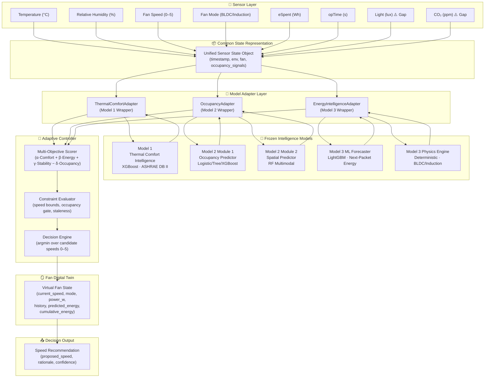
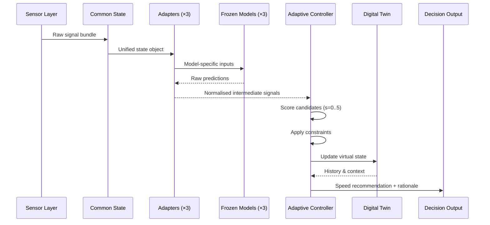

# AACI System Architecture Design

**Document Type:** Architecture Overview
**Phase:** 4 – Architecture & Adaptive Controller Design
**Status:** DESIGN ONLY – No implementation authorized

---

## 1. System Purpose

The Atomberg Adaptive Comfort Intelligence (AACI) system integrates three independently developed, frozen ML intelligence models into a unified adaptive controller. The controller recommends ceiling fan speed settings that jointly optimize:

- **Thermal comfort** – avoid uncomfortable thermal environments
- **Occupancy awareness** – minimize energy waste when rooms are unoccupied
- **Energy efficiency** – prefer lower-energy speed settings for equivalent comfort
- **Operational stability** – avoid rapid, unnecessary speed changes

---

## 2. High-Level System Block Diagram



---

## 3. Layer Descriptions

### 3.1 Sensor Layer

Provides raw environmental and operational readings. The AACI system is designed around the sensor signals available in the Mendeley fan telemetry dataset:

| Signal | Unit | Source | Availability |
|--------|------|--------|-------------|
| Temperature | °C | IoT fan sensor | ✅ Available |
| Relative Humidity | % | IoT fan sensor | ✅ Available |
| Fan Speed | 0–5 | Fan firmware | ✅ Available |
| Fan Mode | BLDC / Induction | Fan firmware | ✅ Available |
| eSpent | Wh | Fan firmware | ✅ Available |
| opTime | seconds | Fan firmware | ✅ Available |
| Light | lux | External sensor | ⚠️ **Gap – Not in fan IoT** |
| CO₂ | ppm | External sensor | ⚠️ **Gap – Not in fan IoT** |

> [!WARNING]
> `Light` (lux) and `CO2` (ppm) are required by Model 2 (Occupancy Intelligence) but are **not available** from the Atomberg fan IoT platform. The OccupancyAdapter must apply documented fallback strategies when these signals are missing. See `model_adapter_specification.md`.

### 3.2 Common State Representation (CSR)

A single unified data object that aggregates all available sensor signals at each decision timestep. This object is the sole input passed to all three model adapters. It provides a clean separation between raw sensor ingestion and model inference.

**CSR JSON schema example:**

```json
{
  "timestamp": "2024-03-15T14:32:00",
  "environmental": {
    "temperature_c": 28.4,
    "relative_humidity_pct": 62.0
  },
  "fan_state": {
    "current_speed": 3,
    "mode": "BLDC",
    "espent_wh": 0.072,
    "op_time_s": 14400,
    "session_cumulative_energy_wh": 124.5
  },
  "occupancy_signals": {
    "light_lux": null,
    "co2_ppm": null,
    "light_available": false,
    "co2_available": false
  },
  "metadata": {
    "room_id": "Bedroom_Fan_1",
    "room_category": "Bedroom",
    "sensor_age_s": 12,
    "data_source": "mendeley_telemetry"
  }
}
```

### 3.3 Model Adapter Layer

Three independent adapters wrap the three frozen models. Adapters are responsible for:

- Translating CSR fields into the exact input format each model requires
- Applying the provisional Dryad speed-to-airvelocity mapping for Model 1
- Handling missing signals (Light, CO₂) gracefully for Model 2
- Invoking both the physics engine and ML forecaster separately for Model 3
- Normalizing each model's output into a common intermediate signal format

**Adapter outputs are intermediate signals, not final decisions.** The Adaptive Controller makes all final speed recommendations.

See `model_adapter_specification.md` for exact contracts.

### 3.4 Frozen Intelligence Models

The three frozen models are called only through their respective adapters. No direct calls from the controller to any frozen model are permitted.

| Model | Type | Primary Capability | Key Limitation |
|-------|------|-------------------|---------------|
| Model 1 | XGBoost Classifier | Thermal comfort label (Cold/Neutral/Hot) | Uncalibrated probabilities; commercial/office training domain |
| Model 2 Module 1 | Logistic/Tree/XGBoost | Binary occupancy prediction | Requires Light + CO₂ – not in fan IoT |
| Model 2 Module 2 | RF Multimodal | Headcount & density estimation | Same sensor gap |
| Model 3 ML | LightGBM Forecaster | Next-packet energy forecast (Wh) | R²≈0.15; variable horizon |
| Model 3 Physics | Deterministic Engine | Instantaneous power + energy calculation | Dryad airflow mapping PROVISIONAL |

> [!NOTE]
> Model 3 contains **two separate and distinct capabilities**: a deterministic physics engine and an ML forecaster. These must never be conflated. The physics engine calculates energy from known speed and duration. The ML forecaster forecasts future packet energy without knowing future speed or duration.

### 3.5 Adaptive Controller

The core decision-making layer. Receives intermediate signals from all three adapters and evaluates a multi-objective scoring function across all six candidate fan speeds (0–5). Applies hard constraints (speed bounds, occupancy gating, staleness limits) before selecting the optimal speed.

See `adaptive_controller_design.md` for the full mathematical specification.

### 3.6 Fan Digital Twin

A virtual representation of the fan's current operational state. Maintained by the controller and updated after each decision cycle. Provides historical context (recent speed transitions, cumulative energy) to the controller for stability penalty calculation.

See `fan_digital_twin_design.md` for the full schema.

### 3.7 Decision Output

The final output of each decision cycle (standardised nested-object schema — consistent with `adaptive_controller_design.md §8` and `decision_logic.md §4.10`):

```json
{
  "proposed_speed": 3,
  "current_speed": 3,
  "speed_change": 0,
  "rationale": "Neutral comfort maintained. Occupancy confirmed. Energy score optimal at speed 3.",
  "comfort_signal": {
    "label": "Neutral",
    "max_probability": 0.61,
    "is_uncertain": false,
    "domain_mismatch_logged": true
  },
  "occupancy_signal": {
    "state": "Occupied",
    "probability": 0.78,
    "is_uncertain": false,
    "sensor_gap_active": true
  },
  "energy_signal": {
    "predicted_next_energy_wh": 0.068,
    "estimated_power_w_current": 20.0,
    "ml_available": true
  },
  "decision_mode": "adaptive",
  "fallback_triggered": false,
  "timestamp": "2024-03-15T14:32:00"
}
```

> [!NOTE]
> `comfort_signal`, `occupancy_signal`, and `energy_signal` are always nested objects, never plain strings. This is consistent with the adapter output schemas in `model_adapter_specification.md` and all worked examples in `decision_logic.md`.

---

## 4. Data Flow Summary



---

## 5. Key Design Principles

1. **Strict model isolation** – Frozen models are invoked only through adapters; adapters are invoked only by the controller.
2. **Separation of concerns** – Physics engine and ML forecaster are separate code paths that serve distinct purposes.
3. **Defensive defaults** – When any model fails or input is stale, the system falls back to a safe known-good speed, not to silence.
4. **Transparency** – Every decision output includes a human-readable rationale and all intermediate confidence scores.
5. **Provisional labelling** – The Dryad airflow mapping (speed → m/s) is always marked PROVISIONAL throughout the system.
6. **No sensor fabrication** – Missing Light/CO₂ sensors are documented and handled via fallback; they are never imputed from temperature or humidity.

---

## 6. Scientific Caveats

> [!WARNING]
> The following caveats apply to the entire system and must be respected in any downstream implementation:

| Caveat | Detail |
|--------|--------|
| Dryad airflow mapping | PROVISIONAL – measured on a different fan at 1.1 m height; no Atomberg hardware calibration |
| Model 1 probabilities | Uncalibrated XGBoost softmax; not Bayesian posteriors |
| Model 1 training domain | ASHRAE commercial/office data; Indian residential context not validated |
| Model 3 R² | ≈0.15 expected; future packet duration and speed are unknown at prediction time |
| Model 3 horizon | Variable (next observed packet), not a fixed time window |
| Model 2 sensor gap | Light and CO₂ not available in fan IoT; occupancy prediction quality is reduced |
| Few-shot adaptation | +0.44% average gain; 4/9 fans slightly worse – not a major capability claim |

