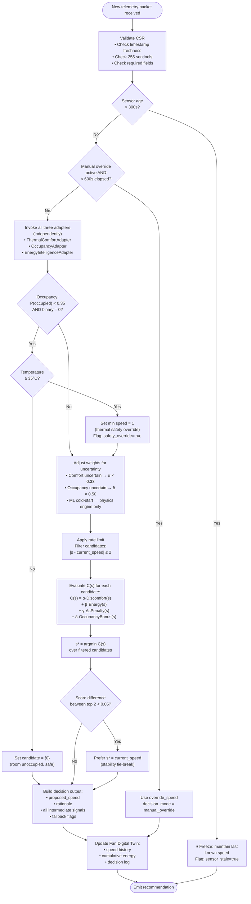

# AACI Decision Logic

**Document Type:** Decision Flowchart & Annotated Trace
**Phase:** 4 – Architecture & Adaptive Controller Design
**Status:** DESIGN ONLY – No implementation authorized

---

## 1. Purpose

This document specifies the complete step-by-step decision logic of the AACI Adaptive Controller, including priority ordering, branching conditions, and an annotated real-value decision trace. It is the reference document for implementing the decision algorithm defined in `adaptive_controller_design.md`.

---

## 2. Decision Priority Hierarchy

The controller applies five decision priorities in strict order. Higher priorities can override lower-priority objective scoring.

| Priority | Name | Description |
|----------|------|-------------|
| P1 | Safety / Override Check | Manual override, thermal safety floor, hardware constraints |
| P2 | Occupancy Gate | Force speed 0 when room is confidently unoccupied |
| P3 | Sensor Staleness Gate | Freeze decision when data is too old |
| P4 | Multi-Objective Scoring | Evaluate all candidates against objective function |
| P5 | Speed Stability | Prefer minimal change when scores are close |

---

## 3. Complete Decision Flowchart

> [!NOTE]
> **MINOR-06 CROSS-DOCUMENT CONSISTENCY (Phase 4.1 verified):** The flowchart below correctly places the Manual Override check **before** adapter invocation (after the Staleness Gate). This ordering matches the corrected pseudocode in `adaptive_controller_design.md §5` (Step 2 of the corrected procedure) and the Priority P1 definition in §2 above. The two documents are now consistent.



---

## 4. Annotated Decision Trace – Full Example

### 4.1 Scenario Setup

**Time:** 14:32 on a March afternoon (Season = Summer)
**Room:** Bedroom, Fan: Bedroom_Fan_1, Mode: BLDC
**Current speed:** 3
**CSR sensor readings:**
- Temperature: 29.2°C
- Relative Humidity: 68%
- eSpent: 0.082 Wh (last packet)
- opTime: 14,520 s (cumulative session)
- Light: not available (fan IoT gap)
- CO₂: not available (fan IoT gap)
- Sensor age: 18 seconds

---

### 4.2 Step 1 – CSR Validation

| Check | Value | Result |
|-------|-------|--------|
| Sensor age | 18 s | ✅ Fresh (< 300 s) |
| Temperature sentinel | 29.2 ≠ 255 | ✅ Valid |
| Humidity sentinel | 68 ≠ 255 | ✅ Valid |
| Required fields present | All present | ✅ Pass |

→ **Proceed to adapter invocation.**

---

### 4.3 Step 2 – Manual Override Check

No override active. Decision mode = `adaptive`.

---

### 4.4 Step 3 – Adapter Invocation

**ThermalComfortAdapter:**
- Speed 3 → provisional air velocity = **0.293 m/s** (PROVISIONAL, Dryad)
- Season derived from March → **Summer**
- Model 1 call: `predict_comfort(29.2, 68.0, 0.293, outdoor_monthly_temp_c=None, clo=0.6, met=1.2, season="Summer", building_type="Office", cooling_strategy="Air Conditioned")`

  > [!NOTE]
  > All 9 parameters are always passed explicitly by the adapter. The `building_type` and `cooling_strategy` defaults retain the Model 1 training domain (commercial/office). The domain mismatch is logged by the adapter as documented in `model_adapter_specification.md §1.4`.

- Result: `Neutral`, P(Cold)=0.14, P(Neutral)=0.62, P(Hot)=0.24
- max_probability = 0.62 ≥ 0.60 → `is_uncertain = false`

**OccupancyAdapter:**
- Light: unavailable, CO₂: unavailable → `sensor_gap_active = true`
- Feature set downgraded to `set_b` (Temperature + Humidity + Hour)
- Call: `predictor.predict({"Temperature": 29.2, "Humidity": 68.0, "Hour": 14})`
- Result: `occupied=1`, `probability=0.81`, `confidence=0.31`
- P=0.81 > 0.65 → `is_uncertain = false`
- Note: `sensor_gap_active = true` logged — prediction quality reduced

**EnergyIntelligenceAdapter:**
- Physics engine: BLDC power map for all 6 speeds
- ML forecaster: 26-feature vector built from rolling history → `predicted_next_energy_wh = 0.074`
- Cold start: false (sufficient lag history available)

---

### 4.5 Step 4 – Occupancy Gate

P(occupied) = 0.81 > 0.35 → **No gate applied.** All speeds remain candidates: {0, 1, 2, 3, 4, 5}.

---

### 4.6 Step 5 – Rate Limit

Current speed = 3. Maximum change ±2.
Filtered candidates: {1, 2, 3, 4, 5} (speed 0 excluded; |0−3|=3 > 2).

---

### 4.7 Step 6 – Uncertainty Weight Adjustment

- Comfort: max_prob=0.62 ≥ 0.60 → α remains **1.5**
- Occupancy: P=0.81 not in [0.35, 0.65] → δ remains **1.0**
- ML forecaster: cold_start=false → ML available

---

### 4.8 Step 7 – Candidate Scoring

**DiscomfortPenalty** is evaluated at each candidate speed using the provisional air velocity and Model 1 probabilities (adapter re-evaluated per speed):

| Speed | Air Vel (m/s) | P(Neutral) | DiscomfortPenalty |
|-------|--------------|------------|-------------------|
| 1 | 0.112 | 0.38 | 0.62 (very likely Hot) |
| 2 | 0.239 | 0.55 | 0.45 |
| 3 | 0.293 | 0.62 | 0.38 |
| 4 | 0.410 | 0.68 | 0.32 |
| 5 | 0.527 | 0.59 | 0.41 |

**EnergyScore** (BLDC, normalised across speeds 1–5):

| Speed | Power (W) | EnergyScore |
|-------|-----------|-------------|
| 1 | 10.0 | 0.00 |
| 2 | 15.0 | 0.13 |
| 3 | 20.0 | 0.26 |
| 4 | 27.0 | 0.45 |
| 5 | 48.0 | 1.00 |

**ΔsPenalty** (current = 3):

| Speed | |s−3| | ΔsPenalty |
|-------|--------|------------|
| 1 | 2 | 0.40 |
| 2 | 1 | 0.20 |
| 3 | 0 | 0.00 |
| 4 | 1 | 0.20 |
| 5 | 2 | 0.40 |

**OccupancyBonus** (P=0.81, EnergyScore complement):

| Speed | OccupancyBonus |
|-------|----------------|
| 1 | 0.81 × 1.00 = 0.810 |
| 2 | 0.81 × 0.87 = 0.705 |
| 3 | 0.81 × 0.74 = 0.599 |
| 4 | 0.81 × 0.55 = 0.446 |
| 5 | 0.81 × 0.00 = 0.000 |

**Total Cost C(s) = 1.5·Discomfort + 0.8·Energy + 0.5·ΔsPenalty − 1.0·OccupancyBonus:**

| Speed | 1.5·D | 0.8·E | 0.5·Δs | −1.0·O | **C(s)** |
|-------|-------|-------|--------|--------|---------|
| 1 | 0.930 | 0.000 | 0.200 | −0.810 | **0.320** |
| 2 | 0.675 | 0.104 | 0.100 | −0.705 | **0.174** |
| 3 | 0.570 | 0.208 | 0.000 | −0.599 | **0.179** |
| 4 | 0.480 | 0.360 | 0.100 | −0.446 | **0.494** |
| 5 | 0.615 | 0.800 | 0.200 | −0.000 | **1.615** |

---

### 4.9 Step 8 – Selection

$s^* = \arg\min C(s) = \textbf{Speed 2}$ (C=0.174)

Score difference between Speed 2 (0.174) and Speed 3 (0.179) = 0.005 < 0.05.

→ **Tie-break: prefer current speed (3).** Speed 3 retained.

---

### 4.10 Step 9 – Decision Output

```json
{
  "proposed_speed": 3,
  "current_speed": 3,
  "speed_change": 0,
  "rationale": "Speed 2 and Speed 3 nearly tied (Δ=0.005). Stability tie-break retains current speed 3. Comfort Neutral at 0.62 confidence. Room occupied (P=0.81). Sensor gap: Light/CO2 unavailable, occupancy quality reduced.",
  "comfort_label": "Neutral",
  "comfort_max_probability": 0.62,
  "occupancy_state": "Occupied",
  "occupancy_probability": 0.81,
  "predicted_next_energy_wh": 0.074,
  "estimated_power_w": 20.0,
  "decision_mode": "adaptive",
  "sensor_gap_active": true,
  "fallback_triggered": false,
  "timestamp": "2024-03-15T14:32:00"
}
```

---

## 5. Edge Case Decision Paths

### 5.1 Unoccupied Room – Night

- Occupancy P=0.12, binary=0 → Hard gate → candidate = {0}
- Temperature 24°C < 35°C → No thermal safety override
- **Decision: Speed 0 (fan off)**

### 5.2 Very Hot Room – Sensor Gap

- Temperature 36°C, occupancy uncertain (P=0.48)
- Thermal safety override → min speed = 1
- Occupancy uncertainty reduces δ to 0.5
- DiscomfortPenalty strongly penalises low speeds
- **Decision: Speed 4 or 5 likely selected**

### 5.3 Model 1 Unavailable

- comfort_signal.model_available = false
- DiscomfortPenalty = 0.33 for all speeds (uniform)
- α remains 1.5 but uniform penalty means energy and occupancy dominate
- **Decision: most energy-efficient speed within rate limit**

### 5.4 Model 3 Cold Start

- ML forecaster unavailable (insufficient lag history)
- EnergyScore computed from physics engine only (unchanged)
- `ml_available = false` logged in output
- **Decision: physics-based scoring proceeds normally**

### 5.5 Manual Override

- User sets speed 5 via app
- Controller notes `override_speed = 5`, `override_start = t`
- For 600 seconds: all decisions return speed 5 regardless of scoring
- After 600 seconds: adaptive mode resumes from current state

