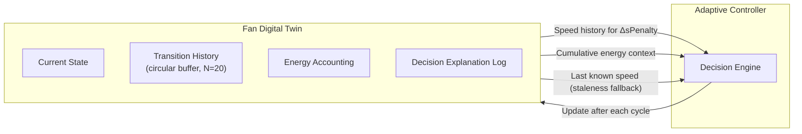
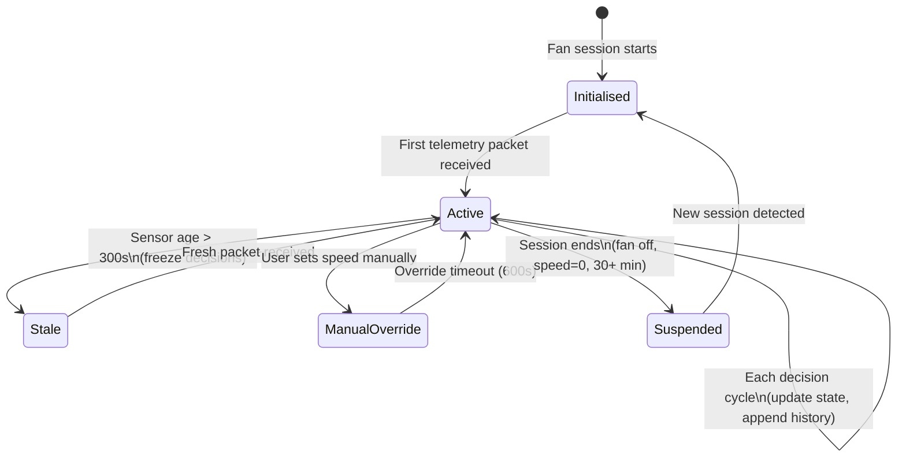

# AACI Fan Digital Twin Design

**Document Type:** Virtual State Representation Specification
**Phase:** 4 – Architecture & Adaptive Controller Design
**Status:** DESIGN ONLY – No implementation authorized

---

## 1. Purpose

The Fan Digital Twin (FDT) is a lightweight in-memory virtual representation of a single ceiling fan's operational state. It maintains a running record of the fan's current configuration, recent operational history, and energy accounting to provide temporal context to the Adaptive Controller.

The FDT is **not** a real-time hardware interface. It does not send commands to physical devices. It is a software state object maintained by the controller and updated after each decision cycle.

> [!WARNING]
> **The Fan Digital Twin has NOT been validated against Atomberg hardware.** Power constants, energy estimates, and airflow values are sourced from:
> - Atomberg product specifications (BLDC and Induction power maps)
> - Dryad open-access dataset (airflow velocity mapping, **PROVISIONAL**)
>
> No hardware-in-the-loop testing has been performed. The FDT is a design-phase simulation tool only.

---

## 2. Digital Twin Role in the System



The Digital Twin serves three primary functions:
1. **Context provider** – supplies speed transition history for the stability penalty calculation
2. **Energy accountant** – maintains session and cumulative energy totals
3. **Fallback anchor** – holds the last confirmed good speed when sensor data becomes stale

---

## 3. Digital Twin State Schema

### 3.1 Top-Level JSON Schema

```json
{
  "fan_id": "Bedroom_Fan_1",
  "room_category": "Bedroom",
  "fan_mode": "BLDC",
  "current_speed": 3,
  "proposed_speed": 3,
  "speed_change_pending": false,
  "estimated_power_w": 20.0,
  "predicted_next_energy_wh": 0.074,
  "predicted_next_energy_source": "LightGBM_ML_ADVISORY",
  "predicted_next_energy_r2_benchmark": 0.1515,
  "cumulative_energy_session_wh": 124.5,
  "cumulative_energy_lifetime_wh": 8472.3,
  "session_start_timestamp": "2024-03-15T08:00:00",
  "state_transition_history": [...],
  "last_decision": {...},
  "last_updated": "2024-03-15T14:32:00",
  "data_quality": {...},
  "provisional_flags": {...}
}
```

### 3.2 Field Definitions

#### Core State Fields

| Field | Type | Description |
|-------|------|-------------|
| `fan_id` | string | Unique fan identifier (e.g., `Bedroom_Fan_1`) |
| `room_category` | string | Room type: `Bedroom`, `Drawingroom`, or `Lounge` |
| `fan_mode` | string | `BLDC` or `Induction` — determines which power map is used |
| `current_speed` | int [0–5] | Last confirmed fan speed setting |
| `proposed_speed` | int [0–5] | Speed recommended by most recent controller decision |
| `speed_change_pending` | bool | Whether `proposed_speed ≠ current_speed` — awaiting acknowledgement |
| `estimated_power_w` | float | Instantaneous power from physics engine at `current_speed` |
| `predicted_next_energy_wh` | float | **ML forecaster output (LightGBM, R²≈0.15). Advisory only. Variable-horizon forecast of the energy that will be consumed during the next observed telemetry packet. NOT measured; NOT physics-derived. Source: `aaci_energy_lightgbm_model.joblib`.** |

#### Energy Accounting Fields

| Field | Type | Description |
|-------|------|-------------|
| `cumulative_energy_session_wh` | float | Total energy accumulated since session start |
| `cumulative_energy_lifetime_wh` | float | Total energy accumulated across all sessions |
| `session_start_timestamp` | ISO 8601 | When the current operating session began |

> [!NOTE]
> Energy accounting uses the **physics engine** (`E = P(s) × Δt`) for session tracking, not the ML forecaster. The ML forecaster's predicted energy is a forward-looking signal, not a backward-looking accounting record.

#### State Transition History

A circular buffer of the last N=20 speed transitions, providing context for the stability penalty and anomaly detection:

```json
"state_transition_history": [
  {
    "timestamp": "2024-03-15T14:31:30",
    "speed_from": 4,
    "speed_to": 3,
    "trigger": "adaptive",
    "comfort_label": "Neutral",
    "occupancy_state": "Occupied",
    "cost_score": 0.179
  },
  {
    "timestamp": "2024-03-15T13:00:00",
    "speed_from": 3,
    "speed_to": 4,
    "trigger": "manual_override",
    "comfort_label": "Hot",
    "occupancy_state": "Occupied",
    "cost_score": null
  }
]
```

| Field | Type | Description |
|-------|------|-------------|
| `timestamp` | ISO 8601 | When this transition occurred |
| `speed_from` | int | Previous speed |
| `speed_to` | int | New speed after this decision |
| `trigger` | string | `adaptive`, `manual_override`, `safety_override`, `staleness_freeze` |
| `comfort_label` | string | Comfort assessment at transition time |
| `occupancy_state` | string | Occupancy assessment at transition time |
| `cost_score` | float or null | Controller objective score that produced this decision |

#### Last Decision Record

Stores the most recent full controller output for logging and auditability:

```json
"last_decision": {
  "timestamp": "2024-03-15T14:32:00",
  "proposed_speed": 3,
  "decision_mode": "adaptive",
  "rationale": "Speed 2 and Speed 3 nearly tied. Stability tie-break retains speed 3.",
  "comfort_signal": {
    "label": "Neutral",
    "max_probability": 0.62,
    "is_uncertain": false
  },
  "occupancy_signal": {
    "state": "Occupied",
    "probability": 0.81,
    "is_uncertain": false,
    "sensor_gap_active": true
  },
  "energy_signal": {
    "predicted_next_energy_wh": 0.074,
    "estimated_power_w": 20.0,
    "ml_available": true
  },
  "fallback_triggered": false
}
```

#### Data Quality Fields

```json
"data_quality": {
  "last_sensor_age_s": 18,
  "sensor_stale": false,
  "sentinel_255_detected": false,
  "light_available": false,
  "co2_available": false,
  "sensor_gap_active": true,
  "ml_cold_start": false
}
```

#### Provisional Flags

```json
"provisional_flags": {
  "airflow_mapping_provisional": true,
  "airflow_source": "Dryad_open_access_dataset_1.1m_height",
  "comfort_probabilities_uncalibrated": true,
  "energy_forecast_r2": 0.1515,
  "hardware_validation_performed": false
}
```

---

## 4. State Lifecycle



### 4.1 Initialisation

On first packet for a fan device:
- Set `current_speed` from telemetry
- Set `fan_mode` from telemetry (BLDC or Induction)
- Set `session_start_timestamp` = now
- Clear `state_transition_history` buffer
- Set all energy accumulators to 0 (or restore from persistent store)
- Set `ml_cold_start = true` (ML forecaster requires lag history)

### 4.2 Normal Update Cycle

After each controller decision:
1. Write `proposed_speed` and `last_decision` record
2. When telemetry confirms new speed (or speed unchanged): set `current_speed = proposed_speed`, `speed_change_pending = false`
3. Append to `state_transition_history` (evict oldest if buffer full)
4. Update energy accumulators using physics engine: `Δenergy = P(current_speed) × elapsed_seconds / 3600`
5. Update `last_updated` timestamp

### 4.3 Cold-Start Resolution

The ML forecaster requires approximately 5–10 historical observations to construct valid lag features. During this period:
- `ml_cold_start = true`
- `EnergyIntelligenceAdapter` falls back to physics-only scoring
- Once sufficient history is accumulated, `ml_cold_start` transitions to `false`

---

## 5. Multi-Fan Support

The Digital Twin design supports one instance per fan device. A supervisor object maintains a dictionary of active twins keyed by `fan_id`:

```json
{
  "Bedroom_Fan_1":  { ... FDT state ... },
  "Bedroom_Fan_2":  { ... FDT state ... },
  "Drawingroom_Fan_1": { ... FDT state ... }
}
```

Twins are independent — one fan's state does not influence another's decisions.

---

## 6. Persistent State (Design Recommendation)

For production use (not yet authorized), the Digital Twin state should be serialisable to JSON and persisted to disk or a lightweight database between sessions. Required fields for persistence:

- `cumulative_energy_lifetime_wh`
- `state_transition_history` (last N entries)
- `session_start_timestamp`
- `fan_mode`
- `fan_id`

Fields that can be reconstructed from telemetry at session start:
- `current_speed`, `estimated_power_w`, all data quality flags

---

## 7. Integration Constraints

| Constraint | Specification |
|-----------|--------------|
| One twin per fan | Keyed by `fan_id` |
| History buffer size | N = 20 transitions |
| State update trigger | Each controller decision cycle |
| Speed change pending timeout | 120 seconds (assume acknowledgement failed; reset to current telemetry speed) |
| Persistent store format | JSON (design recommendation; not yet implemented) |
| Airflow mapping in twin | Always labelled PROVISIONAL |
| Hardware commands | Not in scope — FDT is a software state object only |

