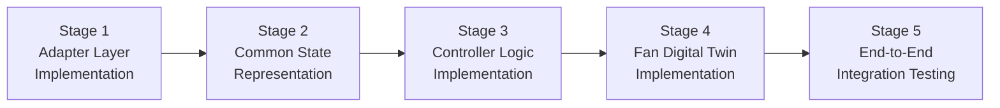

# AACI Integration Roadmap

**Document Type:** Implementation & Testing Roadmap
**Phase:** 4 – Architecture & Adaptive Controller Design
**Status:** DESIGN ONLY – Implementation of any stage requires separate explicit authorization

---

> [!IMPORTANT]
> This roadmap describes future implementation stages. **No implementation has been authorized at this time.** Each stage requires explicit user authorization before work begins. The three frozen ML models (Model 1, 2, 3) must not be modified in any stage.

---

## 1. Overview

The AACI integration roadmap consists of five sequential stages that progressively build from individual adapter implementations to a fully integrated, end-to-end tested adaptive controller system.



---

## 2. Stage 1 – Adapter Layer Implementation

### 2.1 Objective

Implement the three model adapters as specified in `model_adapter_specification.md`. Each adapter wraps its frozen model through the documented public inference interface only.

### 2.2 Files to Create

```
aaci_ml/system_architecture/src/
├── adapters/
│   ├── __init__.py
│   ├── thermal_comfort_adapter.py   ← ThermalComfortAdapter
│   ├── occupancy_adapter.py         ← OccupancyAdapter
│   └── energy_adapter.py            ← EnergyIntelligenceAdapter
└── common/
    └── constants.py                 ← Provisional airflow map, power maps
```

### 2.3 Implementation Requirements

- `ThermalComfortAdapter`:
  - Reads `PROVISIONAL_SPEED_VELOCITY_MAP` from constants (not hardcoded inline)
  - Derives season from timestamp month
  - Calls `predict_comfort()` from `aaci_ml/predict.py` — no other Model 1 interface
  - Sets `is_uncertain = True` when `max_probability < 0.60`

- `OccupancyAdapter`:
  - Inspects sensor availability before selecting feature set (see `model_adapter_specification.md §2.3`)
  - **If Light OR CO₂ unavailable** (normal fan IoT case): uses `set_b` only — never attempts `set_a` or `set_c`
  - **If Light AND CO₂ available** (extended sensor setup): attempts `set_a`, then `set_c`, then `set_b`
  - Feature set definitions (from `data_loader.py`): `set_a` = {Temperature, Humidity, Light, CO₂, HumidityRatio}; `set_b` = {Temperature, Humidity, HumidityRatio, Hour}; `set_c` = {Temperature, Humidity, Light, CO₂}
  - Never fabricates missing Light or CO₂ readings
  - Sets `sensor_gap_active = True` when Light or CO₂ are absent
  - Instantiates `OccupancyPredictor(algorithm, feature_set)` with the selected feature set
  - Instantiates `Module2SpatialPredictor(candidate_model_name, room_id: int)` with an integer room ID

- `EnergyIntelligenceAdapter`:
  - Adds `sys.path.insert(0, 'aaci_ml/v3_energy_intelligence')` before loading preprocessor
  - Maintains per-fan rolling feature buffer for ML forecaster lag features
  - Keeps physics engine and ML forecaster as separate code paths — no mixing
  - `predicted_next_energy_wh` is clearly labelled as variable-horizon forecast

### 2.4 Prerequisites

- All three frozen models must be verified loadable from their respective artifact paths
- `aaci_ml/predict.py` inference interface confirmed working
- `aaci_ml/occupancy_intelligence/src/predictor.py` confirmed working
- `aaci_ml/v3_energy_intelligence/models/` artifacts accessible

### 2.5 Testing Strategy

| Test | Verification |
|------|-------------|
| ThermalComfortAdapter unit test | Correct speed→velocity mapping; correct season derivation; all 9 parameters passed to `predict_comfort()`; domain mismatch logged; exception handling returns fallback output |
| OccupancyAdapter unit test — no Light/CO₂ | `set_b` selected; `set_a`/`set_c` not attempted; `sensor_gap_active = True`; `is_uncertain = True` |
| OccupancyAdapter unit test — Light/CO₂ available | `set_a` selected; correct fallback chain if `set_a` fails |
| OccupancyAdapter unit test — Module 2 instantiation | `Module2SpatialPredictor(room_id: int)` used; integer room ID mapping verified |
| EnergyAdapter unit test | Physics engine and ML paths independent; cold-start returns physics fallback |
| All adapters: exception injection | Adapter never raises to caller; always returns structured fallback output |
| sys.path test | Preprocessor loads correctly when called from outside `v3_energy_intelligence/` directory |

### 2.6 Stage 1 Completion Criteria

- [x] All three adapters implemented and importable (`ThermalComfortAdapter`, `OccupancyAdapter`, `EnergyIntelligenceAdapter`)
- [x] Each adapter returns structured output matching specification (`AdapterOutputEnvelope`)
- [x] No direct calls to frozen model internals bypassing public interface
- [x] Unit tests pass for all adapters (51 new tests passed)
- [x] Exception injection tests demonstrate graceful fallback for all adapters
- [x] No modifications to any frozen model file (60 frozen source & artifact files SHA256 verified)
- [x] `OccupancyAdapter` verified to use `set_b` when Light/CO₂ absent (not `set_a`)
- [x] `Module2SpatialPredictor` instantiated with integer `room_id` (not string)
- [x] `predict_comfort()` called with all 9 parameters explicitly

### 2.7 Stage 1 Rollback Procedure

If Stage 1 fails mid-implementation or completion criteria are not met:

1. Delete all files created under `aaci_ml/system_architecture/src/`
2. Confirm no files outside `aaci_ml/system_architecture/` were modified
3. Verify frozen model artifact timestamps are unchanged (pre-Phase 4 dates)
4. Re-run existing test suite: `python -m pytest aaci_ml/v3_energy_intelligence/tests/ aaci_ml/occupancy_intelligence/tests/ -v`
5. Confirm all 39 existing tests still pass
6. Report rollback status before retrying

---

## 3. Stage 2 – Common State Representation

### 3.1 Objective

Implement the CSR as a data class or dataclass/Pydantic model that aggregates all sensor signals into a validated, typed state object.

### 3.2 Files to Create

```
aaci_ml/system_architecture/src/
└── common/
    ├── __init__.py
    ├── common_state.py    ← CSR dataclass/model
    └── sensor_validator.py ← 255 sentinel detection, range checks
```

### 3.3 Implementation Requirements

- CSR must be constructable from raw telemetry dict (as received from fan IoT or dataset)
- `sensor_validator.py` must:
  - Detect 255 sentinels in temperature and humidity
  - Detect zero-value boot errors (temperature = 0, humidity = 0)
  - Check sensor age against staleness threshold
  - Return a validated CSR or raise a descriptive `SensorValidationError`
- CSR must carry `light_available`, `co2_available` boolean flags (not silently `null`)
- All fields must have typed defaults; no bare `None` without documentation

### 3.4 Testing Strategy

| Test | Verification |
|------|-------------|
| Valid CSR construction | From a real Mendeley telemetry row |
| Sentinel detection | Temperature=255, Humidity=255 detected and flagged |
| Staleness check | Correct flagging of packets older than 300 s |
| Missing field handling | Graceful defaults for optional fields (Light, CO₂) |

### 3.5 Stage 2 Completion Criteria

- [x] CSR dataclass implemented and importable (`CommonState`, `EnvironmentalState`, `OccupancyState`, `FanOperatingState`, `EnergyState`, `SystemHealthState`)
- [x] Sensor validator correctly flags all known error conditions (`CentralizedSensorValidator`: sentinels, boot errors, negative op_time, duplicate timestamps, staleness)
- [x] CSR constructable from Mendeley telemetry rows (verified against standard Mendeley row format)
- [x] Stage 1 adapters accept CSR input (no breaking changes, tested across all 3 adapters)
- [x] Unit tests pass (28 Stage 2 tests + 51 Stage 1 tests + 49 regression tests = 128 total passed)

### 3.6 Stage 2 Rollback Procedure

If Stage 2 fails mid-implementation or completion criteria are not met:

1. Delete all files created under `aaci_ml/system_architecture/src/common/` in this stage (`common_state.py`, `sensor_validator.py`)
2. Confirm that Stage 1 adapter files (`thermal_comfort_adapter.py`, `occupancy_adapter.py`, `energy_adapter.py`) are unmodified (compare against Stage 1 completion snapshot)
3. Confirm no files outside `aaci_ml/system_architecture/` were modified
4. Verify frozen model artifact timestamps are unchanged (pre-Phase 4 dates)
5. Re-run existing test suite: `python -m pytest aaci_ml/v3_energy_intelligence/tests/ aaci_ml/occupancy_intelligence/tests/ -v`
6. Confirm all 39 existing tests still pass
7. Report rollback status before retrying

---

## 4. Stage 3 – Fan Digital Twin Runtime

### 4.1 Objective

Implement the Fan Digital Twin as a stateful runtime class that maintains per-fan operational state, room condition, circular transition histories, and strict 4-way segregated energy accounting.

### 4.2 Implemented Package Structure

```
aaci_ml/system_architecture/digital_twin/
├── __init__.py                 ← Package exports and public interface
├── constants.py                ← Operational buffer depths, triggers, provenance tags
├── state_managers.py           ← FanStateManager, RoomStateManager, EnergyStateManager (4-way segregation)
├── transition_engine.py        ← StateTransitionEngine, StateTransitionRecord
├── history_manager.py          ← HistoricalStateManager (circular buffers N=20, snapshots N=50)
├── fan_digital_twin.py         ← FanDigitalTwin core virtual runtime
├── twin_supervisor.py          ← Fleet manager for multi-fan installations
└── simulator.py                ← DigitalTwinSimulator deterministic replay & synthetic generation
```

### 4.3 Implementation Requirements

- `FanDigitalTwin`:
  - Circular transition history buffer (N=20 transitions)
  - Circular snapshot history buffer (N=50 snapshots)
  - Strict 4-way segregated energy accounting:
    1. Measured telemetry (`measured_espent_wh`)
    2. Nominal research physics estimates (`estimated_power_w`, $E = P(s) \times \Delta t / 3600$)
    3. ML advisory forecasts (LightGBM $R^2 \approx 0.1515$, advisory only, cannot command speed)
    4. Hardware calibrated energy (reserved placeholder `None`)
  - `last_known_speed` persists through staleness events
  - `ml_cold_start` flag transitions to False after observations
  - Manual override state tracked (`manual_override_active`) without sending hardware commands
  - Full state JSON-serializable matching `fan_digital_twin_design.md §3.1`
- `TwinSupervisor`:
  - Dictionary of twins keyed strictly by `fan_id`
  - Automatic instantiation on first observation of unknown fan
  - Isolated state lifecycles across fans
- `DigitalTwinSimulator`:
  - Deterministic replay of operational sequences
  - All synthetic test signals strictly tagged with `"provenance": "SYNTHETIC_SIMULATION"`
  - Never presents synthetic simulation data as real hardware readings

### 4.4 Prerequisites

- Stage 1 (adapters) complete and verified
- Stage 2 (CSR) complete and verified

### 4.5 Testing Strategy

| Test | Verification |
|------|-------------|
| Initial state check | Matches top-level schema and default disclaimers |
| CSR ingestion | Room conditions, fan speed, data quality updated |
| Fan ON/OFF transitions | `FAN_SWITCHED_ON`, `FAN_SWITCHED_OFF` detected |
| Speed transitions | `SPEED_CHANGED` logged with previous and new speeds |
| Energy segregation | Strict 4-way separation with zero blending |
| Multi-fan isolation | Independent state across `TwinSupervisor` instances |
| Staleness & dropout | `SENSOR_STALE`, missing sensors tracked |
| Deterministic replay | Identical inputs produce identical transitions & energy |
| Synthetic labelling | `SYNTHETIC_SIMULATION` tag enforced on all synthetic signals |

### 4.6 Stage 3 Completion Criteria

- [x] Fan Digital Twin runtime implemented (`FanDigitalTwin`, `FanStateManager`, `RoomStateManager`, `EnergyStateManager`)
- [x] Strict 4-way energy segregation implemented and verified (no blending)
- [x] Circular transition buffer (N=20) and snapshot buffer (N=50) operational with chronological ordering and duplicate rejection
- [x] Multi-fan supervisor (`TwinSupervisor`) manages isolated fan instances
- [x] Simulator (`DigitalTwinSimulator`) generates synthetic signals explicitly tagged `SYNTHETIC_SIMULATION`
- [x] All 21 Stage 3 tests pass (149 total test suite passed)
- [x] Zero modifications to frozen models (60/60 SHA-256 match)

---

## 5. Stage 4 – Adaptive Controller Logic

### 5.1 Objective

Implement the multi-objective adaptive controller as specified in `adaptive_controller_design.md` and `decision_logic.md`.

### 5.2 Files to Create

```
aaci_ml/system_architecture/controller/
├── __init__.py
├── adaptive_controller.py   ← Main controller class
├── objective_function.py    ← DiscomfortPenalty, EnergyScore, ΔsPenalty, OccupancyBonus
└── decision_output.py       ← Structured decision output builder
```

### 5.3 Implementation Requirements

- Controller weights (α, β, γ, δ) must be configurable (not hardcoded)
- All five decision priorities (P1–P5) must be implemented in strict order
- Rate limiting (|Δs| ≤ 2) must be applied before objective scoring
- Tie-break (score difference < 0.05 → prefer current speed) must be implemented
- Manual override lockout timer must be maintained per fan
- `build_rationale()` must produce human-readable explanation string for every decision
- Controller must accept CSR directly and return structured decision output

### 5.4 Prerequisites

- Stage 1 (adapters) complete
- Stage 2 (CSR) complete
- Stage 3 (Fan Digital Twin) complete

### 5.5 Testing Strategy

| Test | Verification |
|------|-------------|
| Objective function unit tests | All four terms computed correctly with known inputs |
| Occupancy gate test | Force speed 0 when P(occupied) < 0.35 |
| Thermal safety override | Minimum speed 1 when T ≥ 35°C and unoccupied gate active |
| Rate limit test | No speed change > ±2 in any decision |
| Tie-break test | Current speed retained when top-2 scores differ < 0.05 |
| Manual override test | Speed locked for 600 s; resumes adaptive after timeout |
| All-models-unavailable test | Emergency safe default applied; fallback_triggered = true |
| Staleness test | Decision frozen; last known speed maintained |

### 5.6 Stage 4 Completion Criteria

- [x] Controller instantiates with configurable weights (`alpha`, `beta`, `gamma`, `delta`)
- [x] All priority checks (P1–P5) implemented in documented order (Manual override, Staleness, Thermal floor, Occupancy gate, Rate limiting)
- [x] Objective function terms independently unit-tested (`ComfortScorer`, `OccupancyScorer`, `EnergyScorer`, `DecisionEngine`)
- [x] Decision output matches specification schema (`DecisionExplanation` with 15 standard fields and mandatory disclaimers)
- [x] All 18 Stage 4 test cases pass (167 total test suite passed)
- [x] Zero model retraining or modification (60/60 SHA-256 match)

### 5.7 Stage 4 Rollback Procedure

If Stage 4 fails mid-implementation or completion criteria are not met:

1. Delete all files created under `aaci_ml/system_architecture/src/digital_twin/` in this stage (`fan_digital_twin.py`, `twin_supervisor.py`)
2. Confirm that Stage 1 adapter, Stage 2 CSR, and Stage 3 controller files are unmodified
3. Confirm no files outside `aaci_ml/system_architecture/` were modified
4. Verify frozen model artifact timestamps are unchanged (pre-Phase 4 dates)
5. Re-run existing test suite: `python -m pytest aaci_ml/v3_energy_intelligence/tests/ aaci_ml/occupancy_intelligence/tests/ -v`
6. Confirm all 39 existing tests still pass
7. Report rollback status before retrying

---

## 6. Stage 5 – End-to-End Integration Testing

### 6.1 Objective

Integrate all components and validate the complete AACI pipeline using recorded Mendeley telemetry data as input.

### 6.2 Files to Create

```
aaci_ml/system_architecture/tests/
├── test_integration_e2e.py          ← Full pipeline integration tests
├── test_replay_mendeley.py          ← Telemetry replay tests
└── fixtures/
    └── sample_telemetry_sequences/  ← Curated test sequences from Mendeley dataset
```

### 6.3 Test Scenarios

| Scenario | Description | Validation |
|----------|-------------|-----------|
| Normal operation replay | Replay 100 packets from Bedroom_Fan_1 | No exceptions; stable speed decisions |
| Staleness injection | Inject 400 s gap in telemetry | Freeze confirmed; resume correctly |
| 255 sentinel injection | Inject temperature=255 | Decision blocked; fallback triggered |
| All-models-down simulation | Mock all adapters to raise exceptions | Emergency safe default applied |
| Occupancy gate replay | Replay packets where occupancy is low | Speed 0 recommended appropriately |
| High temperature scenario | Replay or simulate T ≥ 35°C | Thermal safety minimum applied |
| Manual override simulation | Inject override signal; wait 600 s | Lockout respected; adaptive resumes |
| Multi-fan replay | Replay 3 fans simultaneously | Independent twin states maintained |

### 6.4 Prerequisites

- Stages 1–4 complete and individually tested

### 6.5 Stage 5 Completion Criteria

- [x] Full pipeline processes telemetry without exceptions (AACIPipeline verified across 6 demos and 40 e2e tests)
- [x] All test scenarios pass (40/40 integration e2e tests pass; 207/207 full suite pass)
- [x] No modifications to frozen models during testing (60/60 SHA-256 match)
- [x] Full test suite (including Stages 1–4 unit tests) still passes (207 passed in 28.13s)
- [x] Decision logs generated for all test scenarios (pipeline_demo.py 6/6 scenarios logged)
- [x] Phase 5 summary report produced (AACI_Phase5_Stage5_Integration_Report.md)

### 6.6 Stage 5 Rollback Procedure

If Stage 5 fails or completion criteria are not met:

1. Delete all files created under `aaci_ml/system_architecture/tests/` in this stage (`test_integration_e2e.py`, `test_replay_mendeley.py`, `fixtures/sample_telemetry_sequences/`)
2. Confirm that Stage 1–4 implementation files are unmodified
3. Confirm no files outside `aaci_ml/system_architecture/` were modified
4. Verify frozen model artifact timestamps are unchanged (pre-Phase 4 dates)
5. Re-run existing test suite: `python -m pytest aaci_ml/v3_energy_intelligence/tests/ aaci_ml/occupancy_intelligence/tests/ -v`
6. Confirm all 39 existing tests still pass
7. Report failing scenarios and integration gaps before retrying

---

## 7. Known Gaps and Pre-Conditions for Deployment

> [!WARNING]
> The following gaps must be addressed before any production deployment. They are not blocking for the integration testing stage but must be resolved before real-world use.

| Gap | Description | Resolution Required |
|-----|-------------|---------------------|
| Light/CO₂ sensors | Model 2 quality is reduced without these sensors | Hardware sensor addition, or acceptance of reduced occupancy accuracy |
| Dryad airflow calibration | Speed→velocity mapping is PROVISIONAL | Atomberg-specific airflow measurement at representative heights |
| Model 1 calibration | Probabilities are uncalibrated XGBoost softmax | Platt scaling or isotonic regression calibration on Indian residential data |
| Model 1 domain gap | Trained on commercial/office ASHRAE data | Fine-tuning or replacement model trained on residential Indian data |
| Model 3 R² limitation | R²≈0.15; forecaster has limited predictive power without knowing future speed | Accept as research-grade; or collect labelled future-speed data |
| Hardware command interface | Digital Twin makes no hardware calls | Integration with Atomberg fan API or MQTT interface required |
| Controller weight validation | α, β, γ, δ defaults are design estimates | A/B testing or user preference study to tune weights |
| Persistent state storage | Twin state is in-memory only | Implement JSON or database persistence |
| sys.path limitation | Model 3 preprocessor requires path manipulation | Refactor to use absolute imports or package Model 3 properly |

---

## 8. Stage Summary

| Stage | Name | Key Deliverables | Prerequisite |
|-------|------|-----------------|-------------|
| 1 | Adapter Layer | 3 adapter modules, unit tests | Frozen models verified loadable |
| 2 | Common State | CSR dataclass, sensor validator | Stage 1 complete |
| 3 | Controller Logic | Adaptive controller, objective function | Stages 1–2 complete |
| 4 | Digital Twin | FanDigitalTwin, TwinSupervisor | Stage 3 complete |
| 5 | E2E Integration | Full pipeline test, Mendeley replay | Stages 1–4 complete |

> [!NOTE]
> Estimated development effort is architectural estimate only and has not been validated. Each stage should be scoped and estimated independently before authorization.

