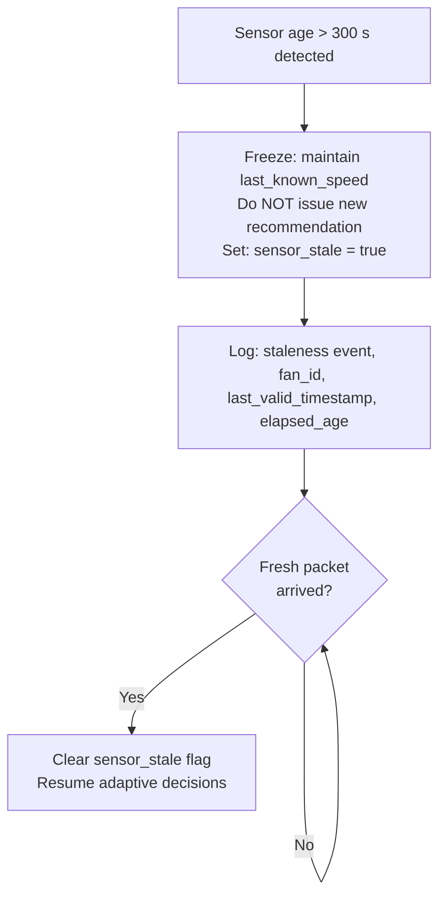

# AACI Safety and Fallback Design

**Document Type:** Safety Architecture & Fallback Specification
**Phase:** 4 – Architecture & Adaptive Controller Design
**Status:** DESIGN ONLY – No implementation authorized

---

## 1. Purpose

This document specifies all safety constraints, sensor staleness handling, model failure fallbacks, and manual override behaviour for the AACI Adaptive Controller. The safety layer is the first decision priority (P1) and can override all other controller outputs.

The AACI system must **never** enter a silent failure mode. All fallback activations must be logged, flagged in the decision output, and communicated to any upstream monitoring system.

---

## 2. Safety Design Principles

1. **Fail to a known safe state** – When uncertain or failing, default to the last confirmed safe speed. Never fail to silence.
2. **Explicit over implicit** – All fallback activations must be logged with reason, timestamp, and the signal that triggered them.
3. **Conservative by default** – When comfort state is unknown, prefer moderate speeds over extremes.
4. **No sensor fabrication** – Missing sensors are acknowledged and handled via fallback. They are never imputed from other unrelated signals.
5. **Transparency** – Every decision output must include `fallback_triggered`, `fallback_reason`, and `safe_default_used` fields.
6. **Human override always wins** – A user-initiated manual override takes precedence over all adaptive decisions for a defined lockout period.

---

## 3. Sensor Staleness Handling

### 3.1 Staleness Definition

A sensor reading is considered **stale** when the elapsed time since the last received telemetry packet exceeds the staleness threshold.

**Recommended staleness threshold: 300 seconds (5 minutes)**

This threshold is based on the observed telemetry packet frequency in the Mendeley fan dataset. Packets typically arrive every few seconds to a few minutes during active operation. A 300-second gap indicates a genuine communication or sensor failure.

### 3.2 Staleness Response



### 3.3 Staleness Thresholds Summary

| Threshold | Duration | Action |
|-----------|----------|--------|
| Warning | > 60 s | Log warning; continue decisions |
| Stale | > 300 s | Freeze decisions; maintain last known speed |
| Critical stale | > 1800 s (30 min) | Assume session ended; transition Digital Twin to Suspended state |

---

## 4. Missing Sensor Handling

| Sensor | Missing Behaviour | Notes |
|--------|------------------|-------|
| Temperature | Block decision; set `sensor_invalid = true` | Temperature is critical for Model 1 |
| Humidity | Block decision; set `sensor_invalid = true` | Humidity is critical for Model 1 |
| Temperature = 255 | Block decision; flag 255 sentinel | Hardware boot error or sensor malfunction |
| Humidity = 255 | Block decision; flag 255 sentinel | Hardware boot error or sensor malfunction |
| Temperature < 5°C OR = 0 exactly | Block decision; flag implausible value | 0°C is physically valid globally but implausible in Indian residential context; treat as boot error. 5°C is the floor for the deployment context. |
| Humidity < 5% OR = 0 exactly | Block decision; flag implausible value | 0% humidity is physically possible in desert conditions but implausible in Indian residential context; treat as boot error. 5% is the floor for the deployment context. |
| Fan Speed | Use last known speed from Digital Twin | Speed is critical for physics engine |
| Fan Mode | Default to BLDC power map; log warning | Most Atomberg fans are BLDC |
| Light (lux) | Downgrade to feature set without Light; `sensor_gap_active = true` | Required by Model 2; not in fan IoT |
| CO₂ (ppm) | Downgrade to feature set without CO₂; `sensor_gap_active = true` | Required by Model 2; not in fan IoT |
| eSpent | Continue without energy accounting update; log warning | Used for lag features in ML forecaster |
| opTime | Continue without physics energy calculation; log warning | Used for energy calculation |

> [!IMPORTANT]
> Temperature and humidity are **blocking sensors** for Model 1. If either is missing or equals 255, no thermal comfort assessment is possible and the controller must fall back to the comfort-unavailable path (see §6).

---

## 5. Model Prediction Failure Handling

### 5.1 Model 1 – Thermal Comfort Intelligence

| Failure Mode | Behaviour |
|-------------|-----------|
| Exception during inference | `comfort_signal.model_available = false`; `comfort_label = "Unknown"`; `is_uncertain = true` |
| Invalid output format | Treat as exception |
| All probabilities = NaN | Treat as exception |

**Fallback scoring when Model 1 unavailable:**
- DiscomfortPenalty = 0.33 for all candidate speeds (uniform; no preference)
- α is effectively neutral — energy and occupancy signals drive the decision
- Rationale must explicitly state: "Thermal comfort model unavailable. Comfort-neutral scoring applied."

### 5.2 Model 2 – Occupancy Intelligence

| Failure Mode | Behaviour |
|-------------|-----------|
| Module 1 exception | `occupancy_signal.model_available = false`; `occupancy_state = "Unknown"`; `is_uncertain = true` |
| No valid feature set (all sensors missing) | `model_available = false`; occupancy gate not applied |
| Module 2 exception | `spatial_module_available = false`; Module 1 result still used |

**Fallback scoring when Model 2 unavailable:**
- Occupancy gate NOT applied — cannot force speed 0 without confident occupancy data
- OccupancyBonus = 0 (no occupancy signal available)
- Controller proceeds with comfort + energy objectives only
- Rationale must state: "Occupancy model unavailable. Occupancy gate not applied. Conservative energy-efficient recommendation used."

### 5.3 Model 3 – Energy Intelligence

| Failure Mode | Behaviour |
|-------------|-----------|
| ML forecaster exception | `ml_available = false`; physics engine used for EnergyScore |
| Preprocessor load failure (sys.path issue) | Log error; `ml_available = false`; physics engine fallback |
| Cold start (insufficient lag history) | `ml_cold_start = true`; physics engine fallback |
| Physics engine exception | `physics_engine_available = false`; use uniform EnergyScore = 0.5 |

> [!NOTE]
> The physics engine is the more reliable fallback since it is fully deterministic (no learned weights). The ML forecaster failure should silently degrade to physics-only scoring without blocking the decision.

---

## 6. Composite Fallback Hierarchy

When multiple failures occur simultaneously, the following hierarchy applies:

```
Level 0: All models available, all sensors fresh
         → Normal adaptive operation

Level 1: Comfort uncertain (max_prob < 0.60)
         → Reduce α weight; continue

Level 2: Comfort model unavailable
         → Uniform DiscomfortPenalty; continue

Level 3: Occupancy model unavailable
         → No occupancy gate; continue with comfort + energy

Level 4: ML forecaster unavailable
         → Physics-only energy scoring; continue

Level 5: Temperature or humidity missing or sentinel
         → Block Model 1 call; fall to Level 2+3

Level 6: Sensor stale (> 300 s)
         → Freeze decisions; maintain last known speed

Level 7: All models unavailable AND sensors stale
         → Emergency safe default (see §7)
```

---

## 7. Emergency Safe Default

When the system cannot obtain any valid model output AND sensor data is stale, the emergency safe default applies:

```
IF no_prior_speed_history:
    safe_speed = 1   (minimum operating speed; prevents heat accumulation)
ELSE:
    safe_speed = last_known_speed  (maintain last confirmed state)

decision_mode = "emergency_safe_default"
fallback_triggered = true
fallback_reason = "All models unavailable and sensor data stale"
```

> [!CAUTION]
> The emergency safe default must **never** set speed to 0 if temperature was last observed ≥ 28°C. In warm conditions, fan-off is not a safe thermal default. Minimum safe speed is 1.

---

## 8. Manual Override Policy

### 8.1 Override Activation

Manual override is triggered when:
- A user explicitly changes the fan speed via the physical control or app interface
- The actual telemetry speed diverges from the controller's proposed speed for two consecutive packets

### 8.2 Override Lockout

Once a manual override is detected:
- `override_speed` = speed set by user
- `override_start` = current timestamp
- For **600 seconds (10 minutes)**: controller returns `override_speed` for all decisions
- `decision_mode = "manual_override"` for all decisions during lockout

### 8.3 Override Expiry

After 600 seconds:
- `decision_mode` transitions back to `"adaptive"`
- Controller resumes normal multi-objective scoring from the current Digital Twin state
- No sudden speed jump at override expiry — the controller evaluates the current state fresh

### 8.4 Override During Emergency Conditions

If temperature ≥ 35°C during manual override:
- Override is **not** cancelled but a warning is logged
- Thermal safety minimum (speed ≥ 1) is still enforced even during manual override

---

## 9. Comfort Uncertainty Policy

When Model 1 max probability < 0.60:

| Condition | Response |
|-----------|----------|
| max_prob < 0.60 | `is_uncertain = true`; α reduced to 0.5 |
| max_prob < 0.40 | `is_uncertain = true`; α reduced to 0.25; comfort signal near-ignored |
| All probabilities approximately equal (< 0.34 spread) | Treat as uniform; α = 0 |

**Rationale:** The ASHRAE-trained Model 1 is known to produce uncalibrated softmax probabilities that do not represent calibrated posterior beliefs. When the model is uncertain, it is more honest to downweight its influence than to act on a weakly supported prediction.

---

## 10. Occupancy Uncertainty Band

| P(occupied) Range | Classification | Occupancy Gate |
|-------------------|---------------|----------------|
| < 0.35 | Confidently Unoccupied | ✅ Applied (force speed 0) |
| [0.35, 0.65] | Uncertain | ❌ Not applied (δ reduced to 0.5) |
| > 0.65 | Confidently Occupied | ❌ Not applied (full δ) |

---

## 11. Speed Constraint Summary

| Constraint | Value | Rationale |
|-----------|-------|-----------|
| Speed minimum | 0 | Off is a valid state |
| Speed maximum | 5 | Hardware limit |
| Max change per cycle | ±2 | Prevents abrupt transitions |
| Thermal safety minimum | 1 (when T ≥ 35°C) | Prevents heat accumulation |
| Manual override lockout | 600 s | Respects user intent |
| Staleness freeze duration | Until fresh packet | No stale-data decisions |
| Emergency safe speed (no history, warm) | 1 | Conservative minimum |

---

## 12. Fallback Decision Output Schema

Every fallback-triggered decision must include:

```json
{
  "proposed_speed": 1,
  "decision_mode": "safety_fallback",
  "fallback_triggered": true,
  "fallback_reason": "Sensor data stale (612s elapsed). Maintaining last known speed.",
  "safe_default_used": true,
  "last_valid_timestamp": "2024-03-15T14:31:00",
  "sensor_stale": true,
  "model_availability": {
    "thermal_comfort": false,
    "occupancy": false,
    "energy_ml": false,
    "energy_physics": true
  },
  "comfort_signal": null,
  "occupancy_signal": null,
  "energy_signal": null,
  "timestamp": "2024-03-15T14:41:42"
}
```

